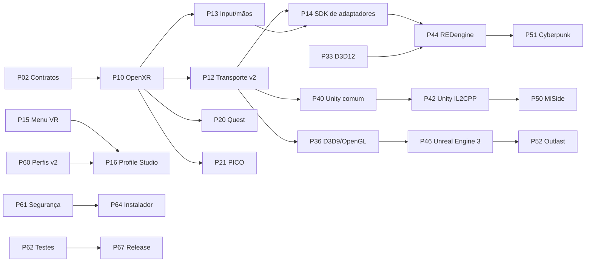

# Pacote mestre de implementação do HaumeaVR

Este diretório é o ponto de entrada para continuar o projeto em outros chats sem depender do histórico da conversa que criou os planos. Ele descreve o produto completo, o estado real do repositório em 11 de julho de 2026, os contratos que todos os módulos devem respeitar e uma sequência executável de planos separados.

Para executar o programa inteiro, e não apenas consultar planos isolados, use [Como implementar tudo](COMO-IMPLEMENTAR-TUDO.md).

## Resultado que o produto deve perseguir

O HaumeaVR deve oferecer a maior cobertura prática possível para jogos de monitor no Windows, com quatro níveis honestos de compatibilidade:

| Nível | Nome | Cobertura pretendida | Cabeça | Controles | Mãos e interação real |
| --- | --- | --- | --- | --- | --- |
| L1 | Virtual Screen | Muito ampla | Move a tela/ambiente | Emulação segura de entradas | Não; ponteiro de menu no máximo |
| L2 | Depth 3D | Ampla quando color + depth são acessíveis | Rotação e translação limitada | Emulação ou adaptador | Não cria interações do jogo |
| L3 | Geometry Stereo | Por API, engine e perfil validado | 6DoF visual quando a câmera é resolvida | Emulação ou adaptador | Somente se houver binding específico |
| L4 | Engine/Game Native | Jogos suportados individualmente | 6DoF completo | Ações semânticas | Sim, quando o adaptador modela mãos, objetos e regras |

“Compatível com qualquer jogo” significa sempre existir um fallback seguro, não prometer L4 universal. Uma pose de mão OpenXR contém juntas e confiança de rastreamento; ela não informa qual porta pode abrir, qual objeto pode ser agarrado nem qual método do jogo deve ser chamado. Essa última ponte pertence a um adaptador e a um perfil de interação por jogo.

## Plataformas iniciais

- Meta Quest em PCVR por Meta Quest Link com cabo ou Air Link. Runtimes alternativos só entram quando forem detectados e validados como OpenXR no PC.
- PICO em PCVR inicialmente por PICO Connect ou Steam Link, usando o runtime OpenXR do SteamVR. Não presumir um runtime OpenXR PICO nativo para Windows.
- Os dois caminhos devem passar pela mesma API OpenXR e pela mesma camada de capacidades. Extensões de mãos, refresh rate, passthrough, eye tracking e recursos de fabricante são opcionais e precisam ser enumerados.
- O alvo desta fase é PCVR Windows. Um APK Android standalone para Quest/PICO é um produto diferente e não faz parte destes planos.

## Como usar este pacote em um novo chat

1. Ler [Método de execução por chat](00-governanca/03-metodo-de-execucao-por-chat.md).
2. Ler [Baseline atual](00-governanca/01-baseline-atual.md) e verificar se ainda corresponde ao código.
3. Abrir o plano escolhido e todos os itens listados em **Dependências**.
4. Implementar apenas o escopo desse plano, sem enfraquecer os contratos globais.
5. Rodar os testes exigidos no próprio plano e atualizar o documento com evidências, decisões e pendências reais.
6. Só marcar um plano como concluído quando a definição de pronto estiver integralmente atendida.

## Índice e ordem recomendada

### Governança

- [P00 — Visão, níveis e promessa](00-governanca/00-visao-niveis-e-promessa.md)
- [P01 — Baseline atual](00-governanca/01-baseline-atual.md)
- [P02 — Contratos arquiteturais globais](00-governanca/02-contratos-arquiteturais-globais.md)
- [P03 — Método de execução por chat](00-governanca/03-metodo-de-execucao-por-chat.md)
- [P04 — Roadmap e grafo de dependências](00-governanca/04-roadmap-e-dependencias.md)
- [P05 — Renomeação integral para HaumeaVR](00-governanca/05-renomeacao-haumeavr.md)

### Fundação

- [P10 — Core OpenXR e capacidades](10-fundacao/10-core-openxr-e-capacidades.md)
- [P11 — Orquestrador de sessão e fallback](10-fundacao/11-orquestrador-de-sessao-e-fallback.md)
- [P12 — Protocolo e transporte v2](10-fundacao/12-protocolo-e-transporte-v2.md)
- [P13 — Entrada, controles, mãos e háptica](10-fundacao/13-entrada-controles-maos-e-haptica.md)
- [P14 — SDK e host de adaptadores](10-fundacao/14-sdk-e-host-de-adaptadores.md)
- [P15 — Menu VR e overlay](10-fundacao/15-menu-vr-e-overlay.md)
- [P16 — Launcher, GUI própria e Profile Studio](10-fundacao/16-launcher-gui-e-profile-studio.md)

### Headsets

- [P20 — Meta Quest PCVR](20-headsets/20-meta-quest-pcvr.md)
- [P21 — PICO PCVR](20-headsets/21-pico-pcvr.md)
- [P22 — Matriz cross-headset](20-headsets/22-matriz-cross-headset.md)

### Renderização

- [P30 — Virtual Screen](30-renderizacao/30-virtual-screen.md)
- [P31 — Depth 3D](30-renderizacao/31-depth-3d.md)
- [P32 — Geometry Stereo D3D11](30-renderizacao/32-geometry-stereo-d3d11.md)
- [P33 — Backend Direct3D 12](30-renderizacao/33-backend-d3d12.md)
- [P34 — Backend Vulkan](30-renderizacao/34-backend-vulkan.md)
- [P35 — Frame pacing, desempenho e conforto](30-renderizacao/35-frame-pacing-desempenho-e-conforto.md)
- [P36 — Backend legado D3D9 e OpenGL](30-renderizacao/36-backend-legado-d3d9-e-opengl.md)

### Engines

- [P40 — Base comum Unity](40-engines/40-unity-base-comum.md)
- [P41 — Unity Mono](40-engines/41-unity-mono.md)
- [P42 — Unity IL2CPP](40-engines/42-unity-il2cpp.md)
- [P43 — Unreal Engine 4 e 5](40-engines/43-unreal-engine-4-e-5.md)
- [P44 — REDengine 4](40-engines/44-redengine-4.md)
- [P45 — Engine genérica ou desconhecida](40-engines/45-engine-generica-ou-desconhecida.md)
- [P46 — Unreal Engine 3 legado](40-engines/46-unreal-engine-3-legado.md)

### Jogos

- [P50 — MiSide](50-jogos/50-miside.md)
- [P51 — Cyberpunk 2077](50-jogos/51-cyberpunk-2077.md)
- [P52 — Outlast](50-jogos/52-outlast.md)
- [P53 — Onboarding de qualquer novo jogo](50-jogos/53-onboarding-de-novo-jogo.md)

### Produto, segurança e distribuição

- [P60 — Perfis, schema e repositório](60-produto/60-perfis-schema-e-repositorio.md)
- [P61 — Segurança, anti-cheat, backup e rollback](60-produto/61-seguranca-anticheat-backup-e-rollback.md)
- [P62 — Testes, labs e matriz de compatibilidade](60-produto/62-testes-labs-e-matriz-de-compatibilidade.md)
- [P63 — Observabilidade, crash e privacidade](60-produto/63-observabilidade-crash-e-privacidade.md)
- [P64 — Empacotamento, instalador, atualização e assinatura](60-produto/64-empacotamento-instalador-atualizacao-e-assinatura.md)
- [P65 — Perfis comunitários, assinatura e moderação](60-produto/65-perfis-comunitarios-assinatura-e-moderacao.md)
- [P66 — Licenciamento, política de mods e compliance](60-produto/66-licenciamento-politica-de-mods-e-compliance.md)
- [P67 — Qualidade, release e suporte](60-produto/67-qualidade-release-e-suporte.md)

## Caminho crítico resumido

## Regras que nenhum plano pode revogar

- Nada de driver de kernel, serviço oculto, bypass de anti-cheat ou suporte invasivo a multiplayer protegido.
- Nada de alterar o runtime OpenXR global como efeito colateral. A seleção continua limitada ao processo por `XR_RUNTIME_JSON`.
- O core é o único dono da sessão OpenXR; adaptadores não abrem uma segunda sessão concorrente.
- Módulos binários precisam ser produzidos e assinados pelo projeto. Perfis da comunidade são declarativos e não carregam DLL arbitrária.
- Todo arquivo alterado dentro de um jogo precisa de inventário, hash, backup e restauração verificável.
- Falha de adapter, Depth ou Geometry nunca pode impedir o jogo limpo de abrir; o usuário deve poder voltar para Virtual Screen ou execução sem HaumeaVR.
- Capability detection prevalece sobre marca/modelo. Nunca ativar um recurso só porque o headset “normalmente” o suporta.
- Logs são locais e redigidos por padrão. Telemetria remota e envio de dump exigem consentimento explícito.

## Fontes oficiais de referência

- [OpenXR 1.1 — especificação Khronos](https://registry.khronos.org/OpenXR/specs/1.1/html/xrspec.html)
- [OpenXR Loader — seleção de runtime no Windows](https://registry.khronos.org/OpenXR/specs/1.1/loader.html)
- [Meta OpenXR SDK e amostras](https://github.com/meta-quest/Meta-OpenXR-SDK)
- [PICO Connect](https://www.picoxr.com/software/pico-link)
- [Steam Link para Meta, HTC e PICO](https://help.steampowered.com/en/faqs/view/0E2C-406B-9135-38A4)
- [Unity: API nativa de renderização](https://docs.unity3d.com/Manual/low-level-native-plugin-rendering-extensions.html)
- [Unity: introdução ao IL2CPP](https://docs.unity3d.com/Manual/il2cpp-introduction.html)
- [Unreal Engine: desenvolvimento OpenXR](https://dev.epicgames.com/documentation/en-us/unreal-engine/developing-for-head-mounted-experiences-with-openxr-in-unreal-engine)
- [Cyberpunk 2077: suporte oficial ao REDmod](https://www.cyberpunk.net/pt-br/modding-support)
- [Outlast no Steam](https://store.steampowered.com/app/238320/Outlast/)
- [Microsoft: Desktop Duplication API](https://learn.microsoft.com/en-us/windows/win32/direct3ddxgi/desktop-dup-api)
- [Microsoft: empacotamento MSIX](https://learn.microsoft.com/en-us/windows/msix/)
